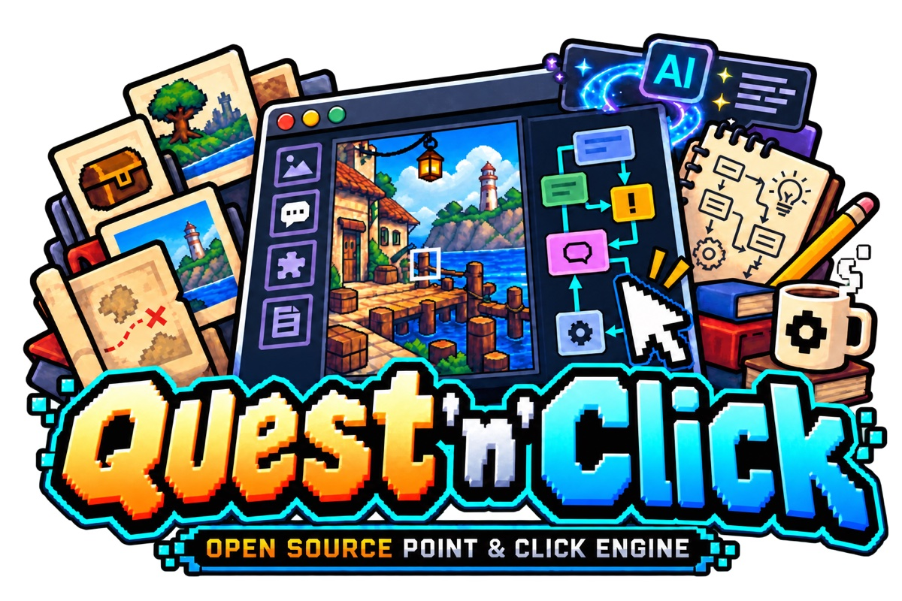

<b>An open-source point-and-click adventure engine for the browser.</b> 
Write the game as data, shape it in a visual Studio, prove it can be finished, ship it as a web game that installs on a phone and plays offline.

  <a href="https://quest-n-click.github.io/play/">Play the demo</a> · <a href="https://quest-n-click.github.io/">Website</a> ·
  <a href="https://quest-n-click.github.io/play/studio.html">Open the Studio</a> ·
  <a href="https://github.com/Quest-n-Click/quest-n-click/wiki">Documentation</a> ·
  <a href="https://github.com/Quest-n-Click/quest-n-click/wiki/FR-Creer-Premier-Jeu">Documentation en français</a>

## Where to go

| I want to… | Repository |
|---|---|
| change the engine, the player, the local Studio, the CLI or the docs | [quest-n-click](https://github.com/Quest-n-Click/quest-n-click) |
| work on the hosted, multi-user Studio (server, worker, deployment) | `studio-server` *(coming)* |
| improve or play the sample games | `games` *(coming)* |
| write or improve a minigame | `minigames` *(coming)* |
| change the website | [quest-n-click.github.io](https://github.com/Quest-n-Click/quest-n-click.github.io) |

Until a repository marked *coming* exists, its code lives in [quest-n-click](https://github.com/Quest-n-Click/quest-n-click).

## Contributing

Start with [CONTRIBUTING](https://github.com/Quest-n-Click/.github/blob/main/CONTRIBUTING.md): how to pick a first
issue, who reviews what, and what a pull request needs. Issues labelled
[`good first issue`](https://github.com/search?q=org%3AQuest-n-Click+label%3A%22good+first+issue%22+state%3Aopen&type=issues)
say what result is expected and which file to open first.

Using an AI assistant is optional. Nothing here requires one, and every pull request is reviewed the same way.
